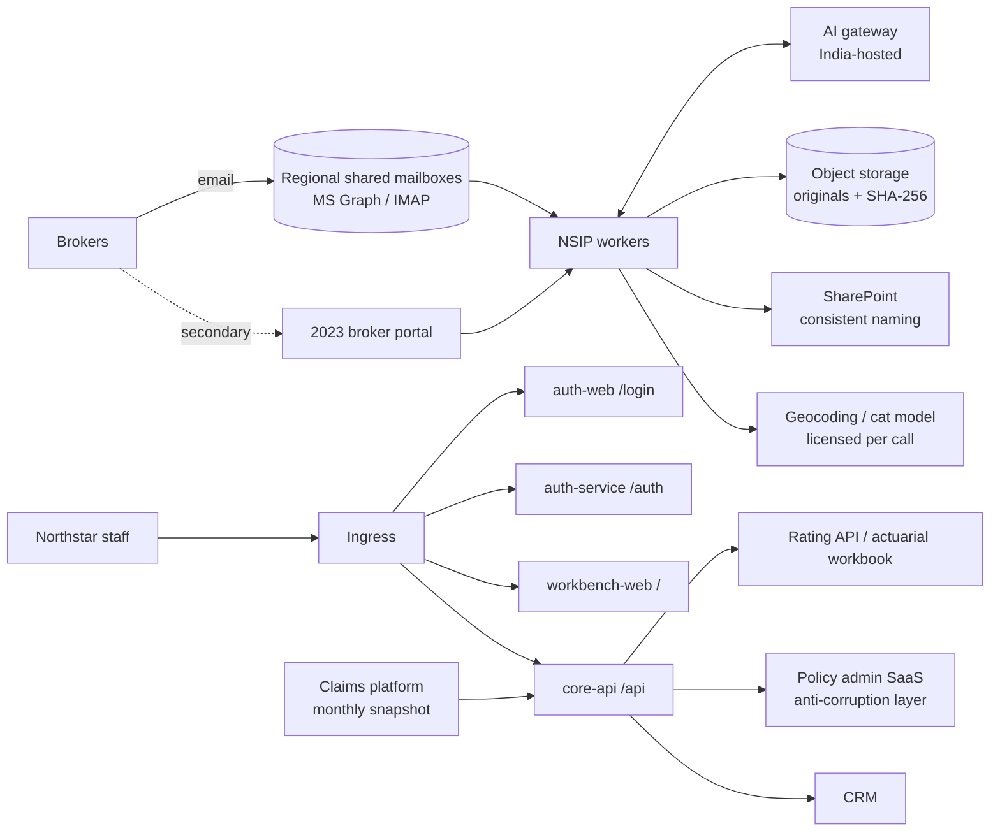

# NSIP Architecture

NSIP is three deployable services and two single-page applications behind one ingress. The workbench never handles passwords, the AI layer cannot reach quoting, and every premium comes from a filed rating source.

## Context



## Deployment units

| Unit | Technology | Owns |
|---|---|---|
| auth-service | FastAPI, Argon2id, pyotp, RS256 JWT | `auth` schema (separate database), signing keys, sessions, auth audit |
| core-api | FastAPI, SQLAlchemy 2, Alembic | core schema, REST API, SSE, dashboards |
| worker / beat | Celery on Redis | mailbox polling, pipeline, retention jobs |
| auth-web | React, Vite | login, MFA, password reset |
| workbench-web | React, Vite, TanStack, Recharts | all staff screens |

Tokens: auth-service signs 15-minute RS256 access tokens and publishes `/.well-known/jwks.json`. core-api verifies with the public keys only. Refresh tokens are opaque, rotated on every use, stored hashed, and kept in an httpOnly, Secure, SameSite=Strict cookie scoped to `/auth`; reuse of a rotated token revokes the whole token family and the session. The approved authority matrix is carried as token claims and re-validated against the core database on every quote action.

## Pipeline

```mermaid
sequenceDiagram
  participant M as Mailbox
  participant I as Ingestion
  participant C as Classify
  participant D as Clearance
  participant T as Triage (rules)
  participant X as Extraction
  participant E as Enrichment
  participant H as Human reviewer
  M->>I: raw .eml (idempotent on Message-ID)
  I->>I: store original + SHA-256, AV scan, macro strip, sanitise, PII registry, injection flags
  I->>C: rules first, small model only if ambiguous
  C->>D: key facts (deterministic parse; LLM only for gaps)
  D-->>H: auto-link or review band (stop before extraction)
  D->>T: deterministic rules on validated features
  T-->>H: out of appetite: drafted decline (one-click send)
  T->>X: in appetite / referral (RE referral raised in parallel)
  X->>X: SOV fingerprint -> deterministic mapper; unknown layout -> LLM header map (saved for approval); OCR for scans
  X->>E: geocode + cat score (cached, budget capped)
  E->>T: post-extraction re-check on material change
  E-->>H: pre-filled submission with confidence + source refs
  H->>H: review, correct, mark ready, rate (filed source), authority check, quote
```

Mid-flight updates follow the email thread (In-Reply-To or References). Only sections present in the new email are re-extracted; a field whose source value is unchanged keeps the human correction; a changed source value on a human-edited field becomes a conflict for the reviewer; nothing reviewed is overwritten silently.

## Hard guards

| Guard | Where it is enforced |
|---|---|
| No automated quotes | `domain/quoting/service.py` accepts only `HumanActor` (constructible only from an authenticated request), requires `confirm=true`, MFA, a current filed rating run and a passing authority check. `tests/architecture` fails if anything under `app/ai` imports quoting or anything but the quoting service constructs a `Quote`. |
| Premiums from filed sources only | `domain/rating/service.py` uses the package rating API or the filed workbook (hash allow-list); the AI schemas have no premium field. |
| Prompt injection | Untrusted text is wrapped in delimited data blocks, PII-masked, outputs schema-validated, the model has no tools, instruction-like text is flagged; routing uses `domain/appetite/engine.py`, which takes only code-derived features. |
| Single AI gateway | `app/ai/gateway.py` is the only module that knows `AI_GATEWAY_URL` (architecture test). |
| Audit | `audit_events` is append-only and hash-chained; an ORM guard and a PostgreSQL trigger reject updates and deletes; `/api/v1/audit/verify` recomputes the chain. |

## Data

All tables use UUID keys and created/updated timestamps; submissions, emails and attachments are soft-deletable; submissions carry `region`, which is enforced in queries and by a PostgreSQL row-level security policy. Personal data detected at ingestion is recorded in `pii_registry` with purpose, legal basis and retention date.

## Scale and cost

Design load is 9,000 submissions a month (about 300 per working day, peaks of 3x). Workers scale on queue depth (KEDA). Cost per submission is tracked from `ai_calls` and `third_party_calls` plus a compute allowance; on the synthetic set it is about Rs 5.6. Cost controls: deterministic SOV mappers before any LLM call, triage before OCR and licensed enrichment, cached geocodes and cat scores, small model tier for classification and advisory notes.
